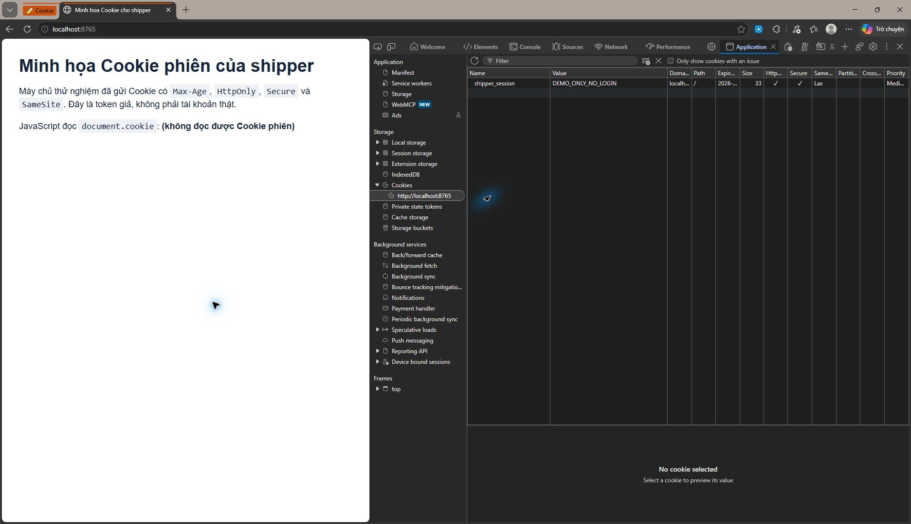

# Bài tập Session 18 – Ex02: Cookie duy trì phiên đăng nhập của shipper

Họ và tên: Thi Thành Đạt  
MSSV: N26DTCN041  
Lớp: CNTT2  
Môn học: Nhập môn Công nghệ thông tin  
Email: thithanhdat111@gmail.com

## 1. Phân tích Cache và Cookie

**Cache** lưu bản sao những tài nguyên như ảnh, CSS và JavaScript để lần sau mở trang nhanh hơn. Dung lượng Cache có thể ở mức MB hoặc GB, tùy trình duyệt và dung lượng máy. Cache có thể bị xóa hoặc thay thế nên không dùng để xác nhận shipper đã đăng nhập. Giao diện còn màu cũ sau khi đã đổi CSS thường là do trình duyệt vẫn dùng bản CSS trong Cache.

**Cookie** thường chỉ chứa khoảng **4 KB cho mỗi Cookie**. Trình duyệt tự gửi Cookie phù hợp kèm các yêu cầu đến máy chủ, nên em chỉ lưu một mã phiên ngắn, không nhét cả giỏ hàng, mật khẩu hay thông tin cá nhân vào đó. Máy chủ dùng mã phiên để tìm đúng tài khoản và giỏ hàng đã lưu ở phía máy chủ.

Cookie phiên thông thường không có thời hạn `Max-Age` và thường hết khi phiên trình duyệt kết thúc. **Persistent Cookie** có `Max-Age` nên có thể còn sau khi đóng rồi mở lại trình duyệt, cho đến khi hết hạn hoặc bị thu hồi. Riêng việc **tải lại trang** mà giỏ hàng mất cũng có thể do giỏ hàng chỉ nằm trong bộ nhớ JavaScript; vì vậy cần lưu giỏ hàng vào tài khoản/phiên ở máy chủ, không chỉ đổi loại Cookie.

## 2. Cấu trúc Cookie và cách hoạt động

Sau khi shipper đăng nhập thành công qua **HTTPS**, máy chủ tạo mã phiên ngẫu nhiên, lưu thông tin phiên ở phía máy chủ rồi trả về ví dụ sau:

```http
Set-Cookie: shipper_session=<ma_phien_ngau_nhien>; Max-Age=604800; Path=/; HttpOnly; Secure; SameSite=Lax
```

- `shipper_session`: tên Cookie; giá trị là mã phiên ngẫu nhiên, không phải mật khẩu hoặc tên người dùng.
- `Max-Age=604800`: giữ tối đa **7 ngày** (604800 giây). Đây là thời hạn **đề xuất cho ví dụ**, có thể rút ngắn theo yêu cầu bảo mật.
- `Path=/`: Cookie áp dụng cho các đường dẫn của ứng dụng.
- `HttpOnly`: JavaScript phía trình duyệt không đọc được mã phiên qua `document.cookie`.
- `Secure`: trình duyệt chỉ gửi Cookie qua HTTPS khi triển khai thật.
- `SameSite=Lax`: hạn chế gửi Cookie trong một số yêu cầu đến từ trang khác.

Khi shipper mở lại trang, trình duyệt gửi mã phiên còn hạn; máy chủ kiểm tra mã đó rồi lấy lại tài khoản và giỏ hàng. Khi đăng xuất, máy chủ phải vô hiệu hóa phiên và xóa Cookie. `HttpOnly` và `Secure` giảm nguy cơ lộ mã phiên qua JavaScript và kết nối không mã hóa, nhưng không thay thế việc phòng lỗi XSS, kiểm tra phiên ở máy chủ và dùng HTTPS cho toàn bộ ứng dụng.

## 3. Hình F12 minh họa và kiểm tra

Em chạy **trang thử nghiệm cục bộ** với token giả `DEMO_ONLY_NO_LOGIN`, sau đó mở **F12 → Application → Cookies → localhost**. Ảnh chụp cho thấy Cookie `shipper_session` có thời hạn hết hạn, cột **HttpOnly** và **Secure** được đánh dấu, `SameSite` là `Lax`. Trên trang, `document.cookie` không đọc được Cookie phiên. Em đã tải lại trang và Cookie vẫn xuất hiện trong F12.



Ảnh này chỉ minh họa cơ chế Cookie; em không có hệ thống vận tải thật để kiểm tra đăng nhập hoặc giỏ hàng. Trang thử nghiệm chạy trên `localhost`, nơi trình duyệt có ngoại lệ cho Cookie `Secure`; khi đưa ứng dụng lên Internet phải dùng **HTTPS**.

## 4. Xử lý giao diện vẫn hiện màu cũ

Trước tiên, tại trang của shipper em nhấn **Ctrl + Shift + R** (hoặc **Ctrl + F5**) để **Hard Reload**: trình duyệt tải lại trang mà không dùng bản Cache cũ cho lần tải đó. Nếu màu cũ vẫn xuất hiện và cần xóa Cache, mở **F12**, nhấn giữ nút tải lại của trình duyệt rồi chọn **Empty cache and hard reload**. Sau đó kiểm tra lại màu giao diện. Hard Reload xử lý tài nguyên giao diện bị lưu đệm; nó không phải thao tác sửa Cookie phiên hoặc dữ liệu giỏ hàng trên máy chủ.
